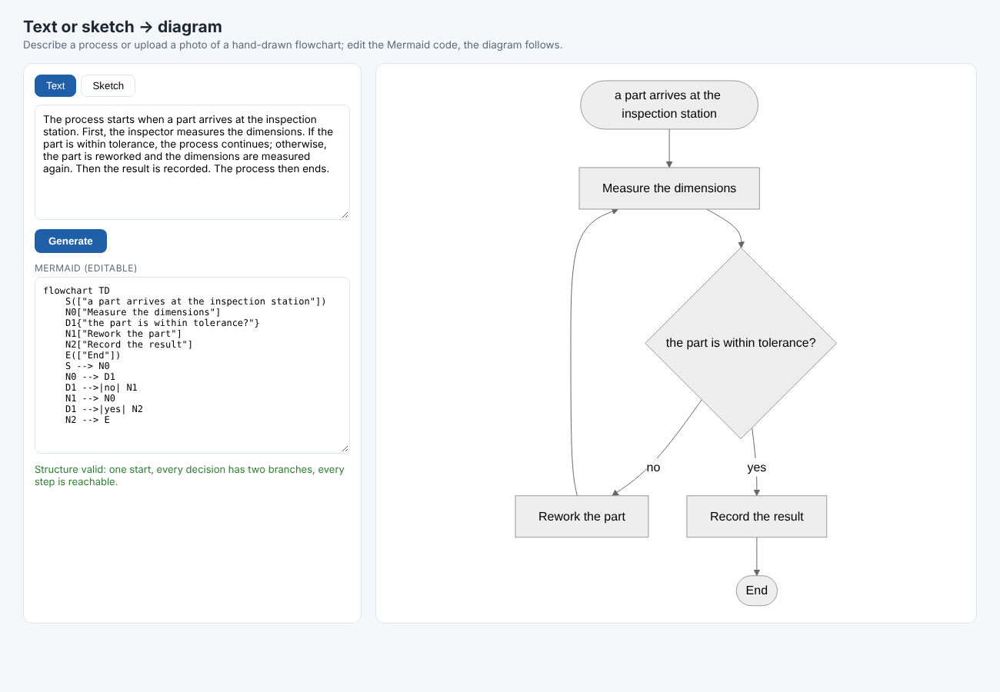
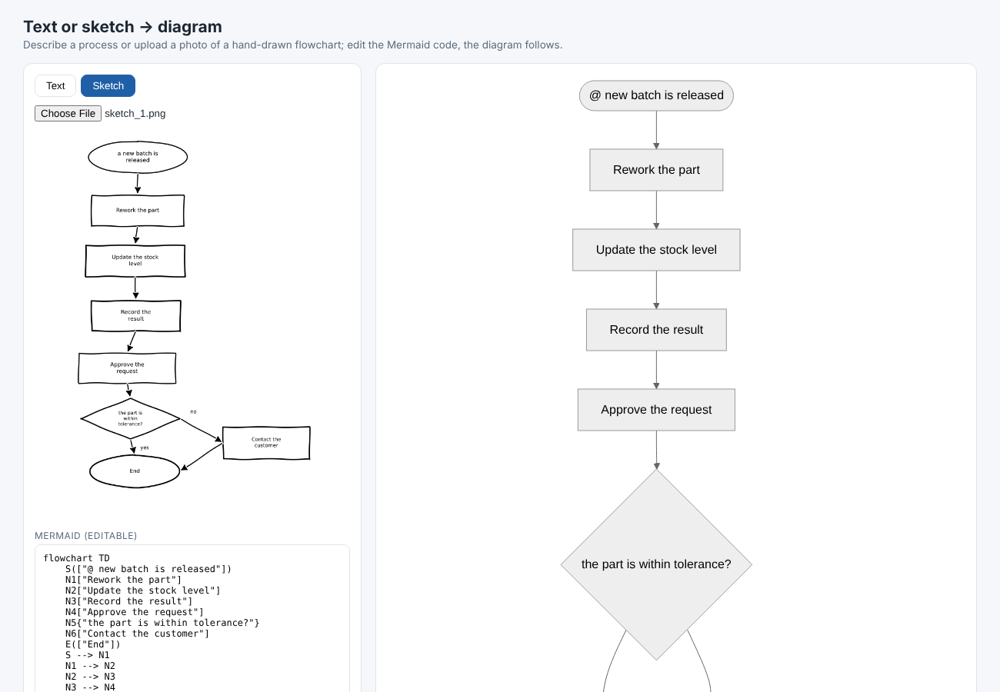
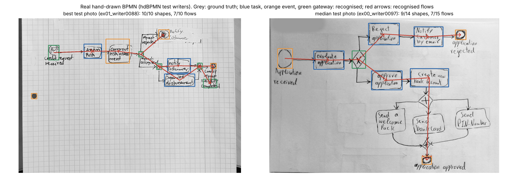
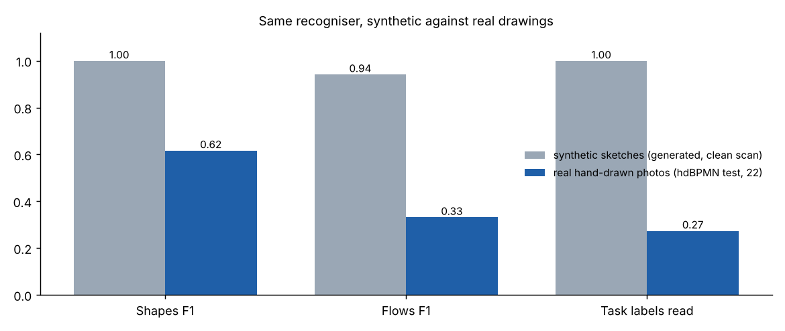

# Text or sketch to diagram: an MCP tool server for flowcharts

[](https://github.com/kawtar-bellamine/sketch2diagram/actions/workflows/tests.yml)

Engineers describe processes in words or sketch them on paper; turning either into a clean diagram is manual work.
This project builds the tools an assistant needs for that job and exposes them through the **Model Context
Protocol (MCP)**, so any agent or chat client can call them:

- `text_to_diagram`: a process description becomes a flowchart (steps, decisions, loops);
- `sketch_to_diagram`: a photo or scan of a hand-drawn flowchart becomes the same structure;
- `validate_mermaid` and `render_diagram`: every output is checked structurally (one start, two branches per
  decision, no dead end, every step reachable) and rendered with the Mermaid CLI before it is returned.

A web interface (TypeScript, Vite, Mermaid) lets the user edit the generated Mermaid code and see the diagram follow.



## How it works

- **Text** ([`s2d/text.py`](s2d/text.py)): sentences are split, connectors (*first, then, once this is done...*)
  removed, and each action becomes a short label *Verb object* from its dependency parse (spaCy), whatever the voice:
  *"the order is checked"* and *"the planner checks the order"* both give *Check the order*. *If ..., otherwise ...*
  becomes a decision with yes / no branches; *"... again"* loops back to the step with the same label.
- **Sketch** ([`s2d/sketch.py`](s2d/sketch.py)), classical computer vision, no training data: nodes are the closed
  regions of the drawing, their fill ratio and corners give the shape (rectangle = step, ellipse = start / end,
  diamond = decision); the text inside is read by OCR (Tesseract); once the nodes are erased, each remaining stroke
  that touches two nodes is an arrow, oriented towards the end with the most ink (the arrowhead); *yes* / *no* are
  attached to the nearest arrow.
- **Real hand-drawn BPMN** ([`s2d/bpmn_sketch.py`](s2d/bpmn_sketch.py)): the same ideas adapted to photos: ink
  measured against the local paper brightness (so the grid of squared paper disappears), solid shapes obtained by
  filling what the ink encloses and opening away the thin strokes, tasks / events / gateways told apart by fill ratio.
- **MCP server** ([`s2d/server.py`](s2d/server.py)), Python MCP SDK, stdio transport: `python -m s2d.server`.
- An OpenAI-compatible multimodal model could replace either path behind the same tools; the validation and rendering
  steps would stay, to catch what a model gets wrong.



## Evaluation on real drawings and real process descriptions

**Data: [hdBPMN](https://github.com/dwslab/hdBPMN)** (Schäfer, van der Aa, Leopold & Stuckenschmidt, CAiSE 2021,
CC BY 4.0), fetched at a pinned commit: process models drawn by hand on paper by students, photographed or scanned,
each with its ground-truth BPMN model. The diagrams of the two exercises restricted to tasks, events, gateways and
sequence flows (the vocabulary of a flowchart) are used: **137 drawings by 137 writers**, with the dataset's writer
split. The sketch recogniser ([`s2d/bpmn_sketch.py`](s2d/bpmn_sketch.py)) has no training: its 12 settings
(ink threshold, opening size, rectangle fill) were chosen on the 30 **validation** writers; it is reported on the
22 **test** writers and, since nothing was trained on them, on the 85 **train** writers as well.

| Real hand-drawn photos | Shapes F1 | Shape type right | Flows F1 | Task labels read (similarity ≥ 70) |
|---|---|---|---|---|
| Validation writers (30, used for the settings) | 0.66 | 95% | 0.30 | n/a |
| **Test writers (22)** | **0.62** | **95%** | **0.33** | **27%** |
| Train writers, never used (85) | 0.53 | 92% | 0.26 | 26% |

On the test photos, 77% of the shapes found are real ones (precision) and 52% of the real shapes are found
(recall): events 71%, gateways 40%, tasks 44%. Of the flows linking two shapes found, 73% are in the right direction.



**Text to diagram on the two real exercise texts**, against the 137 human models of the same texts (each human
model compared with the parser's diagram, and every pair of human models compared with each other as a reference):

| Exercise | Tasks found by the parser | Tasks in a human model (median) | Task agreement with the humans | Agreement between two humans |
|---|---|---|---|---|
| Bank account opening | 2 | 6 | 0.47 | 0.79 |
| Credit risk assessment | 5, two of them wrong (*Need*, *Suffice*) | 5 | 0.36 | 0.84 |

The text parser was frozen before these texts were read; they are reported as they came out.



## Findings

1. **A generated test set flatters the recogniser; real drawings tell the truth.** On sketches drawn by the
   project's own generator, shapes are found every time and flows at F1 0.94. On real photos of hand-drawn diagrams,
   shapes fall to 0.62 and flows to 0.33. What a generator cannot reproduce: squared and lined paper, pencil that is
   barely darker than the grid, phone photos with the desk and a notebook in the frame, rectangles with rounded
   corners or left open, gateways with an X or a + that cuts them into four triangles.

2. **The settings carry over from the validation writers to the test writers** (shapes F1 0.66 then 0.62, flows
   0.30 then 0.33): nothing was overfitted. They carry over less well to the 85 other writers (0.53), whose
   photos are more often taken from a distance: the image the recogniser receives matters as much as the method.

3. **When a shape is found, its type is right 95% of the time**: rectangle, circle and diamond are told apart by
   how much of their bounding box they fill. Detection, not classification, is the bottleneck.

4. **Handwriting defeats a printed-text OCR.** Tesseract reads a task label well enough to be recognised in 27% of
   the cases. A handwriting model (or a vision-language model) is needed for the text; the geometry can stay.

5. **Real process descriptions defeat the rule-based text parser.** On the bank account text it finds 2 of the 6
   tasks a person draws: *"the customer is notified by email"* and the three letters sent in parallel are missed; on
   the credit text it turns *"needs to be carried out"* into a task called *Need*. Two people agree on the tasks at
   0.79 to 0.84, the parser agrees with them at 0.36 to 0.47. This is the measured case for putting a language
   model behind the same tool, with the same structural validation.

6. **Earlier results on generated data, for reference.** On 120 generated sketches the recogniser found 100% of the
   nodes; on 10 descriptions written freely the text parser got 4 diagrams out of 10 right
   ([`results/metrics.json`](results/metrics.json)). These sets helped develop the method; the real sets above are
   the ones that say what it is worth.

All numbers: [`results/metrics_hdbpmn.json`](results/metrics_hdbpmn.json), per photo:
[`results/per_diagram_hdbpmn.json`](results/per_diagram_hdbpmn.json).

## Run it

```bash
pip install -r requirements.txt          # also: tesseract-ocr, and npm install -g @mermaid-js/mermaid-cli
python -m s2d.server                     # MCP server (stdio)
cd web && npm install && npm run build && cd ..
uvicorn app.api:app --port 8000          # web interface on http://localhost:8000
python -m s2d.eval_bpmn                  # real data: fetches hdBPMN (pinned commit), about 2 minutes
python -m s2d.plots_bpmn
python -m s2d.evaluate                   # generated sets (about 6 minutes)
pytest -q
```

## Next steps

- Text: coordination (*X and Y*), a first *"When X"* sentence, pronouns; then compare with an LLM behind the same
  tool, on the same free-text set.
- Sketches: a handwriting OCR or a vision-language model for the labels; perspective correction and cropping of
  phone photos; a small detector trained on the hdBPMN train writers, compared on the same test writers.

Kawtar Bellamine, 2026.
